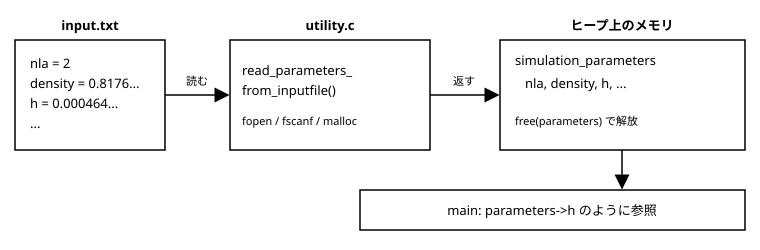

[← 目次に戻る](../README.md)

## 4. **インプットパラメータの読み込み**
コンピュータシミュレーションの強みの一つは多くのパラメータセットで仮想実験が行える点です。前節までのコーディングでは、密度や初期配置等のパラメータを変更する際には直接`.c`のファイルを変更し、再度コンパイルを行う必要があります。
基本的には、ある程度動くようになったシミュレーションのソースファイルを直接いじるという行為は思わぬバグを生みかねないので、慎重に行う必要があります。また、今後例えば平均をとるためのサンプル数を稼ぐために、研究室のクラスターやスパコン上で数〜数百個程度の異なるパラメータセットで計算を回す必要性が出てくると思います。その時に、各パラメータセットに対してソースファイルの変更とコンパイルをいちいち行っていては非効率です。（変数の値の変更とmake、ジョブスクリプトの実行まで自動化することも一応出来はしますが、、、）
そこで、多くのOSSでも行われている通り、パラメータセットを記述したインプットファイルを実行ファイルに読み込ませるという方法を使用します。今回は、拡張性には乏しいですが`fscanf`を使用した最もシンプルな方法で実装してみます。その後、より柔軟な方法についての知りうる限りのtipsを示します。

### 4.1 `scanf`を使ってみる
まずは、実験をしてみましょう。`md_simulation.c`においてインプットパラメータとなりうる変数は以下の通りです。
```c
int nla = 2;  // 面心立方格子の単位格子の数
double density = 0.0;      // 密度
double h = 0.0;            // 時間刻み幅
double target_temp = 0.0;  // 設定温度
int seed = 1;              // 乱数のシード
double finish_time = 1.0;  // 終了時刻
int norm_interval = 10;    // 温度の補正を行う間隔
int output_interval = 100; // 出力を行う間隔
```

また、前節までは`md_simulation.c`内の`non_dimensionalize_parameters()`において、有次元の密度等を与え、その後無次元化まで行っていました。しかし、通常はそもそもパラメータ設定の際に無次元化した値を入れますので、今回もそのようにしましょう。

まずは、読み込みのテストを行うためのソースファイル`4_test_read.c`を作成しましょう。目標としては以下の形のインプットファイル`input.txt`から指定された値を読み込み、変数に代入することです。
```txt
nla = 2
density = 0.817657
h = 0.000465
target_temp = 0.722000
seed = 1
finish_time = 1.0
norm_interval = 10
output_interval = 100
```

読み込み部分を関数にまとめる場合は、ポインタやアドレスのやりとりに注意して実装してください。

### 4.2 パラメータを構造体にまとめる
`4_test_read.c`では、以下のように`read_input_file()`という関数を実装しました。
```c
void read_input_file(char **input_file, int *nla, double *density, double *h, double *target_temp, int *seed, double *finish_time, int *norm_interval, int *output_interval){
    FILE *fp;

    fp = fopen(*input_file,"r");

    // 各引数はポインタなので、`&`をつける必要はない
    fscanf(fp,"nla = %d\n",nla);
    fscanf(fp,"density = %lf\n",density);
    fscanf(fp,"h = %lf\n",h);
    fscanf(fp,"target_temp = %lf\n",target_temp);
    fscanf(fp,"seed = %d\n",seed);
    fscanf(fp,"finish_time = %lf\n",finish_time);
    fscanf(fp,"norm_interval = %d\n",norm_interval);
    fscanf(fp,"output_interval = %d\n",output_interval);

    fclose(fp);
}
```
このように変数の数が非常に多いので、引数の数もそれに応じて多くなってしまっています。
関数に渡す引数の数があまりに多いと、それによって実行速度の低下につながるという話もある他、プログラムが煩雑になりバグの発生確率が高くなるという点においてもデメリットです。そこで、本チュートリアルでは**構造体**を用いてパラメータ群を扱いやすくします。

構造体とは、ざっくり言うといくつかの変数をひとまとまりにしたものです。定義や使用方法については、文法書を参照してください。
とういうことで、構造体を用いて`4_test_read.c`を改善した実装を`4_test_read2.c`に記述していきましょう。
まずは、以下のような構造体を定義します。
```c
typedef struct simulation_parameters
{
    int nla;             // 面心立方格子の単位格子の数
    double density;      // 密度
    double h;            // 時間刻み幅
    double target_temp;  // 設定温度
    int seed;            // 乱数のシード
    double finish_time;  // 終了時刻
    int norm_interval;   // 温度の補正を行う間隔
    int output_interval; // 出力を行う間隔

} simulation_parameters;
```

今回は、main関数内で`simulation_parameters *parameters`のように構造体ポインタを定義します。これは、パラメータを読み込む関数内で作成した構造体を`parameters`に渡す時、そして今後、関数に対して`parameters`を引数として渡す際に、実体渡し（値渡しとも呼ばれる？）ではなくて参照渡し（アドレス渡し）をしたいからです。実体渡しでは構造体の数値全体を直接コピーします。対してアドレス渡しでは名前の通りアドレスを渡すだけなのでこちらの方が計算負荷が小さく速度が下がりにくいです。もちろん構造体のメンバの値も変更可能になります。

続いて、インプットファイルを読み込んだ後、構造体ポインタを返す関数`simulation_parameters *read_parameters_from_inputfile(char **input_file );`を作成してみましょう。
関数内でも`simulation_parameters *parameters`を定義します。この時、構造体のメモリも動的に確保することができます。
```c
parameters = (simulation_parameters *)malloc(sizeof(simulation_parameters));
```
このように実装した場合は、main関数内で必ず`free()`するようにしましょう。

### 4.3 `md_simulation.c`に実装
上記で実装した構造体`simulation_parameters`とインプットファイルを読み込む関数`simulation_parameters *read_parameters_from_inputfile(char **input_file );`を用いて`md_simulation.c`を改善してみましょう。全体の流れは次の図の通りです。



まず、構造体の定義は`common.h`の「型定義」の欄に移します。
```c
typedef struct simulation_parameters
{
    int nla;             // 面心立方格子の単位格子の数
    ...
} simulation_parameters;
```
読み込み関数は`utility.c`に置き、`utility.h`にプロトタイプ宣言を追加します（`utility.h`から`common.h`を`#include`します）。`4_test_read2.c`との違いは、`malloc`の代わりに`xmalloc`を使うことと、エラー処理を入れたことです。
```c
fp = fopen(*input_file,"r");
if(fp == NULL){
    fprintf(stderr,"cannot open input file : %s\n",*input_file);
    exit(EXIT_FAILURE);
}

// fscanf は読み込めた項目の数を返す。1 でなければ書式が合っていない
if(fscanf(fp,"nla = %d\n",&(parameters->nla)) != 1
|| fscanf(fp,"density = %lf\n",&(parameters->density)) != 1
|| ...
|| fscanf(fp,"output_interval = %d\n",&(parameters->output_interval)) != 1){
    fprintf(stderr,"failed to read input file : %s\n",*input_file);
    exit(EXIT_FAILURE);
}
```
ファイル名の打ち間違いや、インプットファイルの書き間違い（行の抜けや順番の間違い）は頻繁に起こります。エラー処理がないと、読み込めなかった変数にはゴミの値が入ったままシミュレーションが走り、おかしな結果が出てから原因を探すことになります。読み込みの時点で止めるのが安全です。（`fopen`が失敗して`NULL`のまま`fscanf`を呼ぶと、そもそも異常終了します。）

`md_simulation.c`の`main`関数では、`argv[1]`でインプットファイル名を受け取ります。引数が足りない場合は使い方を表示して終了します。
```c
if(argc < 2){
    fprintf(stderr,"usage : %s input_file\n",argv[0]);
    exit(EXIT_FAILURE);
}
input_file = argv[1];
parameters = read_parameters_from_inputfile(&input_file);

int nla = parameters->nla;
double density = parameters->density;
double h = parameters->h;
...
```
これまでハードコードしていた値と`non_dimensionalize_parameters()`の呼び出しはなくなります。この関数は不要になったので、`initial_condition.c/h`から削除しました。粒子数`npa`は読み込んだ`nla`から`NUM_FCC_PARTICLE*nla*nla*nla`で計算します（`nla`を読み込んだ後に計算されるよう、宣言の順番に注意してください）。

既存の関数（`init_position_FCC()`や`update_position()`など）には、これまで通り個別の値を渡します。構造体ポインタを渡すようにも書き換えられますが、それぞれの関数が本当に必要な値が見えにくくなりますし、章が進むごとに変更箇所が増えるので、`main`関数の冒頭で一度ローカル変数に取り出す形にしました。ただし、パラメータが増えてきたら構造体ポインタをそのまま渡す設計に移行するのもありです。最後に、確保した構造体を`free(parameters);`で解放します。

`input.txt`には**無次元化済み**の値を書きます。`3_malloc`と同じ結果を再現するために、以前`non_dimensionalize_parameters()`が計算していた値を十分な桁数で書いています。
```txt
nla = 2
density = 0.817657464660018
h = 0.000464811184996788
target_temp = 0.722
seed = 1
finish_time = 1.0
norm_interval = 10
output_interval = 100
```
4.1のように6桁に丸めた値（`h = 0.000465`など）でも動きますが、時間刻み幅が少し変わるため、`3_malloc`の結果とは少しずれます。再現性を確認したい場合は桁数に注意してください。

コンパイルして、インプットファイルを引数に実行します。
```bash
make
./md_simulation input.txt
```
最後の部分は次のように出力され、`3_malloc`と一致します。
```
******* END SIMULATION *********
time (step) potential T 
  1.0003 (2151) -152.3015   0.7181 
```
インプットファイルを指定しない場合は`usage : ./md_simulation input_file`、存在しないファイルを指定した場合は`cannot open input file : ...`と表示されて終了します。これで、`input.txt`を書き換えるだけで（再コンパイル不要で）パラメータを変えられるようになりました。

### 4.4 さらなる拡張
ここで実装した`fscanf`方式は簡単ですが、次のような弱点があります。
- 行の順番が固定されている（`h`と`density`を入れ替えるとエラーになる）
- コメントや空行を書けない
- 知らないキー（`dnsity = ...`のような書き間違い）を検出できない
- パラメータを追加するたびに、構造体と読み込み関数の両方を修正する必要がある

改善の方向としては、「1行ずつ読み、キー（`=`の左側）を取り出してから、一致する名前の変数を探して値を代入する」方式があります。順番は自由になり、`#`で始まる行を読み飛ばしてコメントを許し、どれにも一致しないキーはエラーにできます。ただ、自分で書くと文字列処理が面倒なので、既存のライブラリを使うのが現実的です。

- [inih](https://github.com/benhoyt/inih)：Cで書かれた小さなINIファイルのパーサです。`[section]`と`key = value`の形式の設定ファイルを読み込めます。ソースが数百行程度のファイルなので、プロジェクトに追加しやすいです。
- [Lua](https://www.lua.org/)：軽量なスクリプト言語で、C言語から呼び出せるように設計されています。設定ファイル自体をLuaスクリプトとして書くと、`density = 0.8 * 1.02`のような計算や、`for`文によるパラメータの生成も書けます。

どちらも導入にはそれなりの手間がかかるので、パラメータが増えて`fscanf`方式がつらくなってきたら検討してみてください。

[← 目次に戻る](../README.md)
