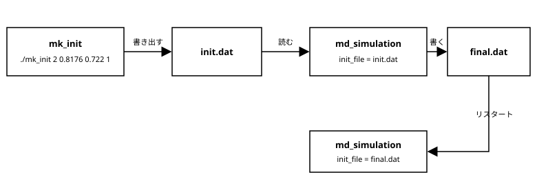

[← 目次に戻る](../README.md)

## 5. **初期配置の読み込み**
前章までは、本計算（`md_simulation`）が起動するたびに、面心立方格子の位置と乱数による速度を作り直していました。LJ粒子の格子配置程度なら一瞬で終わりますが、実際の研究ではそうはいきません。
例えば筆者の扱うMPS法では、粒子数密度をできるだけ一定にする必要がある一方で、あらゆるジオメトリーに格子配置が使えるわけではありません。そのため、ランダムな配置から何かしらのスキームで粒子配置を緩和させて初期配置を作る必要があり、これに時間がかかることがあります。毎回の本計算でこれをやり直すのは非効率です。また、同じ初期配置に対して粒子間相互作用や温度などを変えた計算を行いたい場合も多く、そのたびに初期配置作成のプログラムを本計算に組み込んでおくのは得策ではありません。
そこで、**初期配置の作成は別のプログラムで行い、結果をファイルに書き出して、本計算ではそのファイルを読み込む**形に変更します。



### 5.1 初期配置ファイルの形式
まず、ファイルの形式を決めます。ここでは次のようなテキストファイル（`init.dat`）にします。
```txt
npa = 32
side = 3.3951543596801153
# x y z vx vy vz
0 0 0 2.5887273699320246 -0.4626374549511032 0.21293866959102062
0.84878858992002881 0.84878858992002881 0 -0.92057003284333261 0.77050066118671212 -1.0699625909781718
...
```
- 1行目：粒子数`npa`、2行目：計算領域（立方体）の一辺の長さ`side`、3行目：コメント行
- 4行目以降：粒子1個につき1行、`x y z vx vy vz`の順（`npa`行）

粒子数と`side`もファイルに入れておくことで、本計算は`nla`や`density`を知らなくてよくなります（`input.txt`から削除します）。粒子数は読み込んでから配列を確保できるので、3章の「配列の大きさは実行時に決まる」という話ともつながります。

位置だけでなく**速度も**ファイルに含めるのには理由があります。
- 乱数の扱いを本計算から切り離せます。同じ初期配置から始めたいなら、同じファイルを読めばよく、シードや乱数生成器の実装に依存しません。
- 計算の途中経過を同じ形式で書き出せば、そのままリスタートに使えます（5.4）。

また、値は`%.17g`で書き出します。`double`は`%.17g`で書けば元の値に正確に戻せる（書き出して読み込んでも1ビットも変わらない）桁数です。`%f`のような6桁出力では丸め誤差が入り、4章の`h`のときと同じく、元のプログラムと結果が変わってしまいます。

### 5.2 初期配置作成プログラム`mk_init.c`
`mk_init.c`は独立した`main`関数を持つ別のプログラムです。これまでの`md_simulation.c`の冒頭部分（位置・速度の初期化）をそのまま取り出したものです。パラメータは、`input.txt`ではなくコマンドライン引数で受け取ります。
```c
if(argc < 6){
    fprintf(stderr,"usage : %s nla density target_temp seed output_file\n",argv[0]);
    exit(EXIT_FAILURE);
}
int nla = atoi(argv[1]);
double density = atof(argv[2]);
double target_temp = atof(argv[3]);
int seed = atoi(argv[4]);
char *output_file = argv[5];
```
`atoi`/`atof`は文字列を`int`/`double`に変換する標準関数です。引数の解析をもっときちんと行う方法は、9章のテーマとします（今回は決め打ちの順番で十分です）。

あとは既存の関数を呼ぶだけです。
```c
allocate_arrays(npa,&cd,&vl,&nvl,&fc);

init_position_FCC(nla, side_unit, cd);
init_velocity(seed,npa,vl);
modify_temp(npa,target_temp,vl,nvl);  // 温度補正後の速度が nvl に入る

write_configuration(output_file,npa,side,cd,nvl);
```
書き出し関数`write_configuration()`は、`initial_condition.c`に追加しました。`md_simulation`でも使うので、`mk_init.c`の中には置いていません。
```c
fprintf(fp,"npa = %d\n",npa);
fprintf(fp,"side = %.17g\n",side);
fprintf(fp,"# x y z vx vy vz\n");
for(i = 0; i < npa*3; i += 3){
    fprintf(fp,"%.17g %.17g %.17g %.17g %.17g %.17g\n",
            cd[i],cd[i+1],cd[i+2],vl[i],vl[i+1],vl[i+2]);
}
```

プログラムが2つになったので、`Makefile`も変更します。共通のオブジェクトファイル（`initial_condition.o`など）は両方で使い回します。
```make
OBJECTS = cal_force.o initial_condition.o md_simulation.o temp.o update.o utility.o
OBJECTS_MK_INIT = initial_condition.o mk_init.o temp.o utility.o
TARGETS = md_simulation mk_init

all : $(TARGETS)
...
mk_init : $(OBJECTS_MK_INIT)
	$(CC) -o $@ $(OBJECTS_MK_INIT) $(LDFLAGS) $(LDLIBS)
```
`make`だけで両方が作られます。4章で使っていた`4_test_read*.c`は役目を終えたので、`5_init/`には含めていません。

### 5.3 本計算での読み込み
`input.txt`からは`nla`, `density`, `seed`を取り除き、代わりに初期配置のファイル名`init_file`を追加します。
```txt
h = 0.000464811184996788
target_temp = 0.722
finish_time = 1.0
norm_interval = 10
output_interval = 100
init_file = init.dat
```
構造体`simulation_parameters`(`common.h`)も対応して変更します。ファイル名は文字列なので`char`の配列にし、`fscanf`では`%255s`で読みます。`%s`だけだと配列より長い文字列で溢れるため、最大文字数（配列の大きさ-1）を指定します。
```c
char init_file[256]; // 初期配置ファイル名
...
|| fscanf(fp,"init_file = %255s\n",parameters->init_file) != 1){
```
（配列名はそのままアドレスになるので、`init_file`の前に`&`は不要です。）

初期配置の読み込み関数`read_initial_configuration()`は`initial_condition.c`に置きました。ファイルの先頭で`npa`と`side`を読み、粒子数がわかった時点で`allocate_arrays()`を呼んで配列を確保し、その後に各粒子の行を読みます。配列を関数の中で確保するので、アドレスのアドレス（`double **`）を受け取る点は`allocate_arrays()`と同じです。エラー処理も4章と同様に入れています。
```c
if(fscanf(fp,"npa = %d\n",npa) != 1 || *npa <= 0
|| fscanf(fp,"side = %lf\n",side) != 1
|| fgets(buf,sizeof(buf),fp) == NULL){   // 3行目のコメント行を読み飛ばす
    fprintf(stderr,"failed to read header : %s\n",file_name);
    exit(EXIT_FAILURE);
}

allocate_arrays(*npa,cd,vl,nvl,fc);

for(i = 0; i < (*npa)*3; i += 3){
    if(fscanf(fp,"%lf %lf %lf %lf %lf %lf",
              &(*cd)[i],&(*cd)[i+1],&(*cd)[i+2],&(*vl)[i],&(*vl)[i+1],&(*vl)[i+2]) != 6){
        ...
    }
}
```
`main`関数では、`input.txt`を読んだ後にこの関数を呼びます。
```c
read_initial_configuration(parameters->init_file,&npa,&side,&cd,&vl,&nvl,&fc);
zero_force(npa,fc);
```
これに伴い、`md_simulation.c`から`init_position_FCC()`, `init_velocity()`, `modify_temp()`の呼び出しがなくなりました。**速度の初期化と初期の温度補正は`mk_init`が済ませている**ので、本計算ではファイルの速度をそのまま使います。時間発展の中の温度補正（`norm_temp()`）はこれまで通り行います。
なお、`mk_init`が書き出した速度は温度補正後の速度（4章までの`nvl`）なので、本計算では読み込んだ速度`vl`をそのまま時間発展に使うように書き換えました。`nvl`の配列は`allocate_arrays()`が確保するだけで使われなくなりますが、`mk_init`と確保の関数を共有するために残しています（気になる人は`allocate_arrays()`から外してみてください）。

### 5.4 リスタート
本計算の最後で、最終配置を同じ形式で`final.dat`に書き出します。
```c
write_configuration("final.dat",npa,side,cd,vl);
```
この`final.dat`は`init.dat`と同じ形式なので、`input.txt`の`init_file`に指定すれば、その続きから計算を始められます。

```txt
init_file = final.dat
```
たとえば、平衡化に時間がかかる系で、いったん平衡化した配置を保存しておき、そこから温度などを変えた複数の計算を回す、といった使い方ができます。

ただし、今の実装では時刻とステップ数は0から数え直すので、厳密な意味での「続き」にはなりません（`norm_temp()`を行うタイミングなどもずれます）。ジョブが途中で切れても続きから再開できるような本格的なリスタートを行いたい場合は、時刻やステップ数もファイルに保存する必要があります。

### 5.5 実行例
コンパイルして、まず初期配置を作ります。引数は4章までと同じパラメータ（`nla = 2`, 密度、温度、シード）です。
```bash
make
./mk_init 2 0.817657464660018 0.722 1 init.dat
./md_simulation input.txt
```
最後の部分は次のように出力され、`4_input`・`3_malloc`と一致します。
```
******* END SIMULATION *********
time (step) potential T 
  1.0003 (2151) -152.3015   0.7181 
```
`mk_init`が初期条件を書き出し、`md_simulation`はそれを読み込んだだけなので、物理的には何も変わっていません。同時に`final.dat`が作られます。`input.txt`の`init_file`を`final.dat`に書き換えて実行すると、リスタートできることも確認できます（結果は初期配置が異なるので当然変わります）。

`5_init/`には、サンプルとして32粒子の`init.dat`を置いてあります。`mk_init`を使わなくても、すぐ`md_simulation`を実行して試せます。一方、`final.dat`は実行のたびに作られるファイルなので含めていません。

[← 目次に戻る](../README.md)
