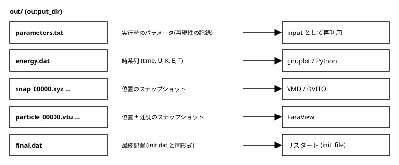

[← 目次に戻る](../README.md)

## 6. **データの出力**
ここまでのプログラムは、標準出力に`time potential T`を表示するだけでした。動作確認には十分ですが、研究では結果をあとから解析し、可視化する必要があります。そのためには、解析しやすい形式でファイルに残さなければなりません。また、MDの出力は簡単に巨大になるので、容量への配慮も必要です。この章では次のことを行います。

- 出力先のディレクトリを作り、結果をまとめて保存する
- 実行時のパラメータも一緒に記録する（あとで「このデータはどの設定で作ったのか」がわからなくなるのを防ぎます）
- エネルギーなどの時系列データと、粒子位置のスナップショットを書き出す
- スナップショットは、VMD/OVITO向けの`xyz`形式と、ParaView向けの`vtu`形式で出す

出力の関数は、新しく作った`output.c`/`output.h`にまとめました。



### 6.1 出力ディレクトリとパスの作成
`input.txt`に、出力先のディレクトリ名`output_dir`と、スナップショットを出力する間隔`snapshot_interval`（ステップ数）を追加します。
```txt
init_file = init.dat
output_dir = out
snapshot_interval = 200
```
構造体`simulation_parameters`(`common.h`)と、`input.txt`の読み込み関数も4章と同様に変更します。`snapshot_interval`が0以下だと、あとで`step%snapshot_interval`が計算できない（0での剰余になる）ので、読み込み時にエラーにしています。

プログラムの開始時にディレクトリを作ります。
```c
#include <errno.h>
#include <sys/stat.h>   // mkdir (POSIX)

void make_output_dir(const char *dir){
    if(mkdir(dir,0755) != 0 && errno != EEXIST){
        fprintf(stderr,"cannot make output directory : %s\n",dir);
        exit(EXIT_FAILURE);
    }
}
```
`mkdir()`は標準Cではなく**POSIX**の関数です（LinuxやmacOSでは使えます）。`0755`は作られるディレクトリの権限（所有者は読み書き実行、他の人は読み実行）です。すでにディレクトリがある場合は失敗して`errno`が`EEXIST`になりますが、これはエラーではないので無視します。それ以外の失敗（権限がない、など）のときだけ終了します。

ファイルは、すべてこのディレクトリの中に作ります。パスは`snprintf`で組み立てます。
```c
static FILE *open_in_dir(const char *dir, const char *name, const char *mode){
    char path[512];
    FILE *fp;

    snprintf(path,sizeof(path),"%s/%s",dir,name);
    fp = fopen(path,mode);
    if(fp == NULL){
        fprintf(stderr,"cannot open file : %s\n",path);
        exit(EXIT_FAILURE);
    }
    return fp;
}
```
`sprintf`でなく`snprintf`を使うのは、**書き込む最大バイト数を指定できる**からです。`sprintf`では、ディレクトリ名が長いと`path`の大きさを超えて書き込んでしまい（バッファオーバーフロー）、5章で`%255s`にしたのと同じ問題が起きます。また、`fopen`の返り値が`NULL`でないかを毎回確認しています。出力先がなかったり書き込み権限がなかったりすると`NULL`になり、そのまま`fprintf`すると異常終了するためです。この確認を`open_in_dir()`にまとめておけば、ファイルを開く場所すべてに同じ`if`を書かなくて済みます。

### 6.2 パラメータの記録
実行開始時に、使ったパラメータを`parameters.txt`に書き出します。
```c
fprintf(fp,"h = %.17g\n",parameters->h);
fprintf(fp,"target_temp = %.17g\n",parameters->target_temp);
...
fprintf(fp,"output_dir = %s\n",parameters->output_dir);
fprintf(fp,"snapshot_interval = %d\n",parameters->snapshot_interval);
```
形式は`input.txt`と同じです。そのため、`./md_simulation out/parameters.txt`のように**そのまま入力ファイルとして使え**、同じ計算をやり直せます。実数は5章と同じ理由で`%.17g`にしています。ただし、実際に使った初期配置ファイル（`init_file`）の中身までは記録されません。初期配置も一緒に保管しておく必要があります。

### 6.3 時系列データ
`energy.dat`には、`output_interval`ごとに1行ずつ書きます。
```txt
# time potential kinetic total temperature
0.000465 -178.446173 33.577783 -144.868390 0.722103
0.046946 -173.838759 32.514380 -141.324379 0.699234
...
```
先頭の`#`で始まる行にそれぞれの列の意味を書いておきます。`#`始まりの行はgnuplotやNumPyの`loadtxt`がコメントとして読み飛ばしてくれます。また、列は空白区切りにしておくと、どのソフトでも読みやすいです。

運動エネルギーは、質量を1として$\frac{1}{2}\sum_i v_i^2$で計算します。`temp.c`に追加しました。
```c
double calc_kinetic(int npa, double *vl){
    int i;
    double vl2 = 0.0;
    for(i=0; i<npa*3; i++){ vl2 += vl[i]*vl[i]; }
    return 0.5*vl2;
}
```
`main`関数では、温度`T`を計算した直後（温度補正の前）にこの関数を呼びます。そうすれば、`T`・運動エネルギー・ポテンシャルエネルギーがすべて同じ時刻のものになります。
```c
T = calc_temp(npa,vl);
knt_erg = calc_kinetic(npa,vl);
...
if(step%output_interval==0){
    write_energy(fp_energy,time,pot_erg,knt_erg,T);
    printf("%8.4f %8.4f %8.4f \n",time,pot_erg,T);
}
```
標準出力への表示も、進捗の確認用に残しています。

`total`（ポテンシャルエネルギー + 運動エネルギー）の列もありますが、**保存量にはなりません**。この計算では`norm_interval`ごとに速度をスケーリングして温度を補正しているので、その度に運動エネルギーが人為的に変わります。エネルギーが保存するかどうかを調べたいときは、温度補正をやめた（NVEの）計算を別に行う必要があります。

プロットは、たとえばgnuplotなら次の1行で行えます。
```bash
gnuplot -e "set terminal png; set output 'energy.png'; plot 'out/energy.dat' u 1:2 w l t 'potential', '' u 1:3 w l t 'kinetic'"
```
Pythonなら次のようになります。
```python
import numpy as np
import matplotlib.pyplot as plt

t, pot, knt, tot, temp = np.loadtxt("out/energy.dat", unpack=True)
plt.plot(t, pot, label="potential")
plt.plot(t, knt, label="kinetic")
plt.legend(); plt.savefig("energy.png")
```

### 6.4 スナップショット
粒子の位置のスナップショットは、`snapshot_interval`ステップごとに書き出します。`main`関数の時間発展の前（`step = 0`）にも書くので、初期配置も残ります。ファイル名の番号は`step/snapshot_interval`にしています。
```c
write_xyz(output_dir,0,npa,time,cd);      // step 0 のスナップショット
write_vtu(output_dir,0,npa,cd,vl);
...
step ++;
if(step%snapshot_interval==0){
    write_xyz(output_dir,step/snapshot_interval,npa,time,cd);
    write_vtu(output_dir,step/snapshot_interval,npa,cd,vl);
}
```
ファイル名は`snap_%05d.xyz`のように`%05d`で0埋めの5桁にしています。こうすると、ファイル名の並び（辞書順）が時間の順に一致し、ソフトが連番のファイルをまとめて読み込むときに順番が狂いません。

#### xyz形式（VMD, OVITO）
最も単純な形式です。
```txt
32
time = 0.278887
Ar 0.304932 0.112036 3.381956
Ar ...
```
1行目が粒子数、2行目が自由なコメント（ここでは時刻）、3行目以降は粒子1個につき1行で`元素名 x y z`です。ここでは、LJ粒子といえばアルゴンなので`Ar`としています。粒子数+2行のファイルになります。VMDやOVITOで開くと、粒子が球として表示されます。ただし、1ファイルが1フレームなので、複数のファイルを連続で読み込む必要があります（OVITOはファイル名の連番を認識して、まとめて読んでくれます）。

#### vtu形式（ParaView）
ParaViewが読むVTKのXML形式（`.vtu`）で書きます。粒子の位置に加えて、速度のベクトルも持たせられるので、速度の大きさや向きで色を付けるといった可視化ができます。筆者がMPS法のコードで使っているものを簡略化して、必要最小限にしました。ここでは読みやすさのためASCII（テキスト）で書いています。
```xml
<?xml version='1.0' encoding='UTF-8'?>
<VTKFile xmlns='VTK' byte_order='LittleEndian' version='0.1' type='UnstructuredGrid'>
<UnstructuredGrid>
<Piece NumberOfCells='32' NumberOfPoints='32'>
<Points>
<DataArray NumberOfComponents='3' type='Float32' Name='Position' format='ascii'>
0.304932 0.112036 3.381956
...
</DataArray>
</Points>
<PointData>
<DataArray NumberOfComponents='3' type='Float32' Name='Velocity' format='ascii'>
...
</DataArray>
</PointData>
<Cells>
<DataArray type='Int32' Name='connectivity' format='ascii'> 0 1 2 ... </DataArray>
<DataArray type='Int32' Name='offsets' format='ascii'> 1 2 3 ... </DataArray>
<DataArray type='UInt8' Name='types' format='ascii'> 1 1 1 ... </DataArray>
</Cells>
</Piece>
</UnstructuredGrid>
</VTKFile>
```
（`Cells`の部分は、実際のファイルでは1行に1つずつ値が並びます。）

- `Points`：粒子の位置（x, y, zの3成分）
- `PointData`：粒子ごとの量。ここでは`Velocity`（3成分のベクトル）。圧力や粒子の種類などを増やしたければ、`DataArray`をもう一つ追加するだけです。
- `Cells`：点をつないで作る図形（セル）の定義です。粒子は点でしかないので、「点1個だけのセル」（`types`が1、VTK_VERTEXという種類）を粒子の数だけ作ります。`connectivity`はセルを構成する点の番号、`offsets`は各セルの`connectivity`の終わりの位置です。1点のセルなので、それぞれ`0,1,2,...`と`1,2,3,...`になります。

`Float32`にしているのは、可視化に倍精度は不要で、容量が半分で済むからです（ASCIIで書く桁数も`%f`の6桁にしています）。**計算を続けるための完全な情報は、5章の`final.dat`（`%.17g`）の方で残します。** スナップショットは、あくまで可視化・解析用です。

ParaViewでの開き方は次の通りです。
1. `File → Open`で`out`ディレクトリ内の`particle_..vtu`を選ぶと、連番のファイルが1つのグループにまとまって表示されるので、そのまま`OK`
2. 左の`Properties`で`Apply`を押す（まだ何も表示されないことがあります）
3. `Filters → Glyph`（メニューの検索は`Ctrl+Space`）を追加し、`Glyph Type`を`Sphere`にして`Scale Array`を`No scale array`、`Scale Factor`を粒子の半径程度（0.5程度）にして`Apply`
4. 上のバーの再生ボタンで、時間（連番）に沿って粒子が動くアニメーションを見られます。`Coloring`を`Velocity`にすると、速度で色が付きます。

### 6.5 容量対策
出力ファイルの大きさを見積もってみます。今回の1粒子・1フレームあたりのバイト数は、ASCIIで書いているので文字数から数えられます。
- xyz：`Ar 0.304932 0.112036 3.381956\n`で約30バイト
- vtu：位置が約27バイト、速度が約30バイト、`connectivity`などが合計10バイト弱で、約65〜70バイト

合計で1粒子・1フレームあたり約100バイトです。実際に、32粒子の1フレームのファイルは、xyzが約1 kB、vtuが約2.7 kBでした。ここで**10万粒子を1000フレーム**出力すると、
$$100\ \text{B} \times 10^5 \times 10^3 = 10\ \text{GB}$$
になります。これはxyzとvtuを両方書いた場合で、研究で使うような大きな計算ではさらに膨れ上がります。対策には次のようなものがあります。

- **出力間隔を見直す**：`snapshot_interval`を大きくします。解析したい現象の時間スケールより細かく出しても、ほとんどは無駄になります。
- **必要な量だけ出す**：可視化に速度は要らないなら、書かない。使わない形式は（ここではxyzとvtuを両方出していますが）どちらか一つにする。粒子の一部だけを出す、という方法もあります。
- **バイナリ形式で書く**：`fwrite`で`double`をそのままの形で書けば、1つの数値が8バイト（`float`なら4バイト）で済みます。ASCIIの1つの数値は10バイト前後なので、小さくなる上に、書き込みと読み込みも速くなります。ただし、テキストエディタで中身を見られなくなり、読み込むプログラムを別に書く必要があります。VTKにもバイナリ形式（base64で埋め込む形式など）があります。
- **圧縮する**：`gzip`などで圧縮します。テキストはよく圧縮できるので、数分の1になることが多いです。ファイルを書き出したあとに`gzip`コマンドを使えば済みます（VMDやOVITOは`.gz`をそのまま読めることもあります）。

この章のコードでは、まず扱いやすさを優先してASCIIで書いています。必要に応じて、上のような方法を検討してください。

### 6.6 実行例
`final.dat`も、`output_dir`の中に書き出すようにしました。
```c
snprintf(path,sizeof(path),"%s/final.dat",output_dir);
write_configuration(path,npa,side,cd,vl);
```
コンパイルして実行します。
```bash
make
./md_simulation input.txt
```
最後の部分は次のように出力され、これまでの章と一致します（出力を追加しただけで、物理的には何も変わっていません）。
```
******* END SIMULATION *********
time (step) potential T 
  1.0003 (2151) -152.3015   0.7181 
```
同時に、`out/`が次のようになります。
```txt
out/
├── energy.dat
├── final.dat
├── parameters.txt
├── particle_00000.vtu ... particle_00010.vtu
└── snap_00000.xyz ... snap_00010.xyz
```
2151ステップを200ステップごとに出力しているので、step 0を含めて11個のスナップショットができます。また、`./md_simulation out/parameters.txt`としても、同じ結果になることを確認できます。

出力ディレクトリ`out/`は実行のたびに作られるファイルなので、`6_output/`には含めず、`.gitignore`で除外しています。

[← 目次に戻る](../README.md)
