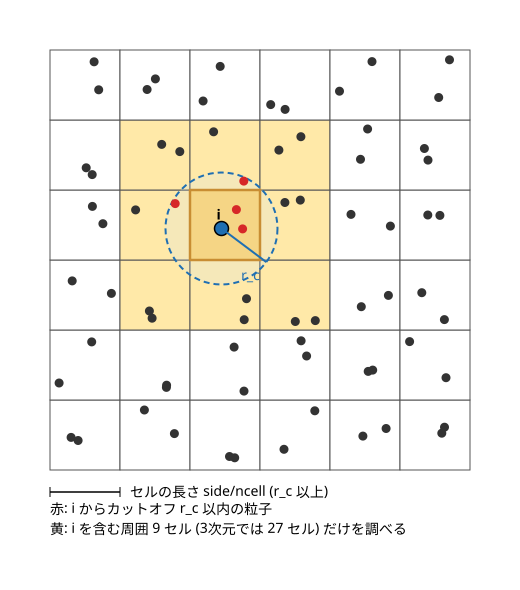
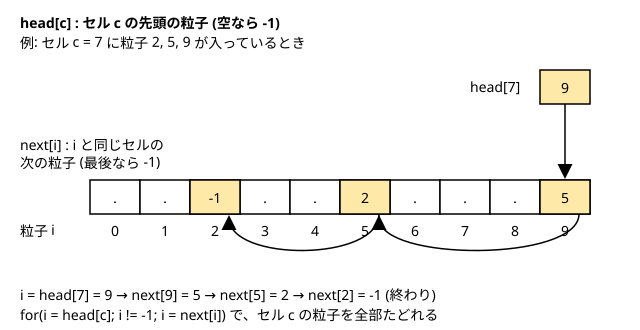

[← 目次に戻る](../README.md)

## 7. **セルリストの実装**
これまでのプログラムは、力の計算で**すべての粒子の組**の距離を調べていました（`calc_force_pot_LJ()`の二重の`for`ループ）。粒子数を$N$とすると、組の数は$N(N-1)/2$なので、計算量は$N^2$に比例します。粒子数を10倍にすると計算時間は約100倍になり、数万粒子以上の計算は現実的ではなくなります。

一方で、LJ粒子どうしの力は距離とともに急激に小さくなるので、ある距離（**カットオフ**）より遠い粒子との力は無視してしまうのが普通です。遠い粒子の組は計算しても意味がないのに、距離を調べるためだけに$N^2$回のループを回しているのは無駄です。そこで、**カットオフ以内にある粒子だけを効率よく探す**方法が必要になります。その代表的なものが**セルリスト**です。この章では次のことを行います。

- カットオフ距離をインプットパラメータにする
- 箱を小さなセルに分けて、粒子を所属するセルごとに整理する（連結リスト）
- 注目する粒子の周囲のセルだけを調べて力を計算する
- 総当たり版と結果が一致することを確かめる
- 計算時間を比べる



### 7.1 カットオフの導入
これまでの`calc_force_pot_LJ()`は、カットオフを箱の半分（`side/2`）に固定していました（コードにも「本当はこれもインプットパラメーター」とコメントしてあります）。これを`input.txt`の`cutoff`で指定するようにします。LJ粒子では、$r_c = 2.5$（$\sigma$ の2.5倍）がよく使われます。
```txt
snapshot_interval = 200
cutoff = 2.5
```
構造体`simulation_parameters`(`common.h`)、`input.txt`の読み込み、`parameters.txt`への書き出しも、4・6章と同様に`cutoff`を追加しました。`cutoff`が0以下のときは読み込み時にエラーにしています。総当たり版の`calc_force_pot_LJ()`にも引数`cutoff`を追加しました。
```c
double calc_force_pot_LJ(int npa, double *cd, double *fc, double side, double cutoff){
    ...
    double cut_off2 = cutoff * cutoff;
```
**この変更で、計算結果は6章までと変わります**。カットオフが`side/2`から2.5に変わり、力に入れる組が変わるからです。なお、ここでは`r2 < cut_off2`の組だけを足し合わせるだけで、ポテンシャルをカットオフでゼロになるようにずらす（シフトする）処理はしていません。そのため、粒子がカットオフを横切るときにポテンシャルエネルギーが不連続に変化します。研究で使うときは、シフトや打ち切りの補正を入れるかどうかも検討してください。

### 7.2 セル分割の考え方
箱を、1辺が$L/n_{cell}$の立方体の**セル**に分割します（$L$は箱の1辺`side`）。セルの長さをカットオフ以上にしておけば、**注目粒子から$r_c$以内にある粒子は、必ず自分のセルか、その隣のセルにいます**。つまり、3次元なら自分のセルを中心とした$3\times3\times3 = 27$個のセルだけを調べれば十分です（図は2次元で描いているので9セルです）。

セルの数は、セルの長さがカットオフ以上になるように、端数を切り捨てて決めます。
```c
int ncell = (int)(side/cutoff);   // セル長 side/ncell は cutoff 以上になる
```
たとえば`side = 8.49`, `cutoff = 2.5`なら`8.49/2.5 = 3.4`なので`ncell = 3`で、セルの長さは$8.49/3 = 2.83$です。

**`ncell`が3未満の場合は動かしません**（エラーで終了します）。`ncell = 2`だと、周囲27セルの「左隣」と「右隣」が周期境界のせいで同じセルになり、同じ粒子の組を2回数えてしまうからです。`ncell = 1`だと自分自身が27回現れます。これまで例にしてきた`nla = 2`（32粒子, `side = 3.4`）は、`3.4/2.5 = 1`なので、セルリストは使えません。セルリストが使えるのは、箱がカットオフの3倍以上ある系、つまり**ある程度大きい系**です。セルリストは大きい系のための方法で、小さい系では総当たりで十分です。7章では`nla = 5`（500粒子, `side = 8.49`）の初期配置を使います。
```bash
./mk_init 5 0.817657464660018 0.722 1 init.dat
```

### 7.3 連結リストによる粒子の整理
どのセルにどの粒子がいるかを、**連結リスト**で整理します。Allen & Tildesley の本に書かれている方法で、次の2つの配列だけを使います（`cell_list.c`）。

- `head[c]`: セル`c`の先頭の粒子の番号（粒子がいなければ`-1`）
- `next[i]`: 粒子`i`と**同じセルの次の粒子**の番号（最後なら`-1`）



セル`c`にいる粒子は、`head[c]`から始めて`next`を順にたどると全部見つかります。
```c
for(i = head[c]; i != -1; i = next[i]){
    // 粒子 i はセル c にいる
}
```
`head`の大きさは`ncell^3`、`next`の大きさは粒子数`npa`です。「セルごとに粒子の配列を持つ」方法だと、セルあたりの最大の粒子数を決めておく必要があります（足りないとバッファを超えて書き込みます）が、連結リストならこの2つの配列だけで済みます。この2つの配列は、粒子数と箱の大きさが決まった後で`main`関数で確保し（`allocate_cell_list()`、`xmalloc()`を使うので`utility.c`のものを`static`でなくしました）、最後に`free`します。

セルの番号は、3次元のセルの位置`(ix, iy, iz)`から`ix + iy*ncell + iz*ncell*ncell`とします。リストは**毎ステップ作り直します**（粒子が動くとセルが変わるため）。
```c
void make_cell_list(int npa, double *cd, double side, int ncell, int *head, int *next){

    int i,c;
    int ix,iy,iz;
    double cell_len = side / ncell;

    for(c = 0; c < ncell*ncell*ncell; c++){ head[c] = -1; }

    for(i = 0; i < npa; i++){
        ix = (int)(cd[3*i]  /cell_len);
        iy = (int)(cd[3*i+1]/cell_len);
        iz = (int)(cd[3*i+2]/cell_len);
        // 座標がちょうど side のとき ix == ncell になってしまうので、最後のセルに入れる
        if(ix >= ncell){ ix = ncell - 1; }
        if(iy >= ncell){ iy = ncell - 1; }
        if(iz >= ncell){ iz = ncell - 1; }
        c = ix + iy*ncell + iz*ncell*ncell;

        next[i] = head[c];  // 今までの先頭を i の次にして、
        head[c] = i;        // i を新しい先頭にする
    }
}
```
粒子`i`をセル`c`の先頭に挿入しているだけです。`next[i] = head[c]`で、それまでの先頭を自分の次につなぎ、`head[c] = i`で自分を先頭にします。粒子を1回なめるだけなので、作成の計算量は$N$に比例します。

座標の`if`文は**境界の処理**です。`apply_PBC()`は、座標が0以下のとき`side`を足します（`update.c`）。このとき座標が丁度0（あるいは0に極めて近い負の値）だと、足した結果が丁度`side`になることがあります。この座標をそのまま使うと`ix == ncell`となって、`head`の範囲の外を読んでしまいます。そこで、このときは最後のセル（`ncell - 1`）に入れています。

### 7.4 セルリストを使った力の計算
`calc_force_pot_LJ_cell()`は、総当たり版`calc_force_pot_LJ()`と同じ引数に、`head`と`next`を加えたものです。力の初期化のあとでセルリストを作り、各セルの粒子`i`について、周囲27セルの粒子`j`との組を調べます。
```c
for(cz = 0; cz < ncell; cz++){
for(cy = 0; cy < ncell; cy++){
for(cx = 0; cx < ncell; cx++){
    // 周囲の27セル (自分を含む)。周期境界なので端の外側は反対側のセルに巻き戻す
    for(ez = -1; ez <= 1; ez++){
    for(ey = -1; ey <= 1; ey++){
    for(ex = -1; ex <= 1; ex++){
        nx = (cx + ex + ncell) % ncell;
        ny = (cy + ey + ncell) % ncell;
        nz = (cz + ez + ncell) % ncell;

        for(i = head[cx + cy*ncell + cz*ncell*ncell]; i != -1; i = next[i]){
            c = nx + ny*ncell + nz*ncell*ncell;
            for(j = head[c]; j != -1; j = next[j]){
                if(j <= i){ continue; }
                // 距離の計算, 力の計算 (総当たり版と同じ)
```
ポイントは次の3つです。

- **周期境界**: 隣のセルの番号は`(cx + ex + ncell) % ncell`で巻き戻します。`cx = 0`で`ex = -1`のとき、`-1 + ncell`を`ncell`で割った余りで、反対側の端のセル`ncell - 1`になります。`ncell`を足してから`%`を取るのは、Cでは負の数の剰余が負になるためです。
- **同じ組を2回数えない**: 総当たり版と同じく、`j > i`の組だけを計算します。そして、作用反作用の法則で`fc[i]`と`fc[j]`を両方更新します。`ncell >= 3`なら、どの組も、`i`のセルから見た27セルのうち、ちょうど1つで`j`に出会うので、ちょうど1回ずつ計算されます。
- **距離の計算**: 周期境界の最小イメージ規約の部分や、`r2 < cut_off2`の判定、力とポテンシャルの式は総当たり版と全く同じです。セルリストは「どの組を調べるか」を絞り込んでいるだけなので、力の式は変わりません。

`main`関数では、力の計算を`calc_force_pot_LJ_cell()`に置き換えます。
```c
pot_erg = calc_force_pot_LJ_cell(npa, cd, fc, side, cutoff, head, next);
```

### 7.5 検証: 総当たり版との比較
新しいアルゴリズムを実装したときは、**必ず、すでに正しいとわかっている古い実装と結果を比べて確かめてください**。セルリストは、セルの境界や周期境界の処理など、間違えやすい部分が多く、間違えても「それらしい結果」が出てしまうことがあります（粒子の組をいくつか数え落としても、プログラムは止まらず、エネルギーがすこしずれるだけです）。MD全体を動かして「なんとなく合っている」と判断するのではなく、**力の計算だけを取り出して、同じ配置に対する結果を数値で比べる**のが確実です。

そのためのプログラム`test_cell_list.c`を作りました。初期配置ファイルを読み、粒子を少しずらしてから（格子点のままだと距離が揃いすぎて、境界のミスを見逃しやすいため）、総当たり版とセルリスト版で力とポテンシャルエネルギーを計算し、最大の差を表示します。差が$10^{-10}$より大きければ`NG`と表示し、`exit`のステータス1で終了します。
```c
pot      = calc_force_pot_LJ(npa,cd,fc,side,cutoff);
pot_cell = calc_force_pot_LJ_cell(npa,cd,fc_cell,side,cutoff,head,next);

for(i = 0; i < 3*npa; i++){
    err = fabs(fc[i] - fc_cell[i]);
    if(err > err_f){ err_f = err; }
}
```
`Makefile`にも`test_cell_list`のターゲットを加えました。
```bash
make
./test_cell_list init.dat 2.5
```
```txt
npa = 500, side = 8.487886, cutoff = 2.500000
potential : -3235.022197025551 (all pairs) -3235.022197025548 (cell list)
max |force error| = 5.440e-15, |potential error| = 2.728e-12
OK
```
力は$10^{-15}$程度（倍精度の丸め誤差）、ポテンシャルエネルギーも$10^{-12}$で一致しました。完全に同じ値にならないのは、足し算の順番が変わるため丸め誤差が異なるからです。誤差がこの程度なら、実装は正しいと考えてよいでしょう。粒子数や`cutoff`を変えて何度か試すと、より安心できます。

### 7.6 計算時間の比較
総当たり版とセルリスト版で、計算時間がどう変わるかを測ります。`nla`を変えて`mk_init`で初期配置を作り（密度と温度は同じ）、`input.txt`の`finish_time`を`0.05`（107ステップ）に短くして実行しました。総当たり版は、`md_simulation.c`の`calc_force_pot_LJ_cell(...)`の呼び出しを一時的に`calc_force_pot_LJ(npa, cd, fc, side, cutoff)`に書き換えたコピーを作り、`date`コマンドで全体の実行時間（ファイル出力を含む）を測っています。計測した環境はApple SiliconのMacで、1回ずつの計測なので目安として見てください。

| nla | 粒子数 | 総当たり [s] | セルリスト [s] |
|---:|---:|---:|---:|
| 5 | 500 | 0.05 | 0.07 |
| 6 | 864 | 0.12 | 0.10 |
| 8 | 2048 | 0.56 | 0.23 |
| 10 | 4000 | 2.23 | 0.50 |
| 12 | 6912 | 5.86 | 0.75 |

どの条件でも、2つの版の最終行は同じ値になりました（たとえば`nla = 12`では`0.0502 (107) -44017.1351 0.7080`）。粒子数が約3.4倍（2048→6912）になったとき、総当たり版の時間は約10倍（$3.4^2 \approx 11$）、セルリスト版は約3.3倍でした。総当たり版は$N^2$に、セルリスト版は$N$に比例する傾向がよく見えています。粒子数が小さいときは、セルリストを作る手間があるので、総当たり版と大差ないか、むしろ遅くなります。

セルリスト版が$N$に比例するのは、**密度が一定ならセルあたりの粒子数が粒子数によらず一定**だからです。1つの粒子が調べる相手は、周囲27セルの粒子だけで、これは$N$によらないので、全体で$N$に比例します。セルリストの作成も$N$に比例します。

### 7.7 実行例
`nla = 5`の初期配置`init.dat`を使って、これまでと同様に実行します。
```bash
make
./mk_init 5 0.817657464660018 0.722 1 init.dat
./md_simulation input.txt
```
最後の部分は次のようになります。カットオフが6章までと違うので、6章の結果とは一致しません（粒子数も違います）。
```
******* END SIMULATION *********
time (step) potential T 
  1.0003 (2151) -2750.0656   0.7245 
```
粒子数が増えたので、ポテンシャルエネルギーは粒子数に比例して大きくなっています（1粒子あたり約$-5.5$）。

### 7.8 発展
セルリストの他にも、**Verlet の近傍リスト**（帳簿法）という方法があります。各粒子について「カットオフより少し大きい距離以内にいる粒子」のリストを作っておき、リストは何ステップかに1回だけ更新して、その間は同じリストを使い回します。セルリストと組み合わせて使われることも多く、詳細は参考文献（Allen & Tildesley, 淡路氏の解説）を参照してください。


**【参考文献】**
- [Computer Simulation of Liquids,  M.P. Allen and D.J. Tildesley, p146-155](https://academic.oup.com/book/27866)
- [短距離古典分子動力学法における加速化手法の系統的構築 新潟大M2 淡路大輔](http://mercury.yukawa.kyoto-u.ac.jp/~bussei.kenkyu/pdf/05/2/0079-052601.pdf)
- [粒子法入門 越塚 誠一]()


[← 目次に戻る](../README.md)
