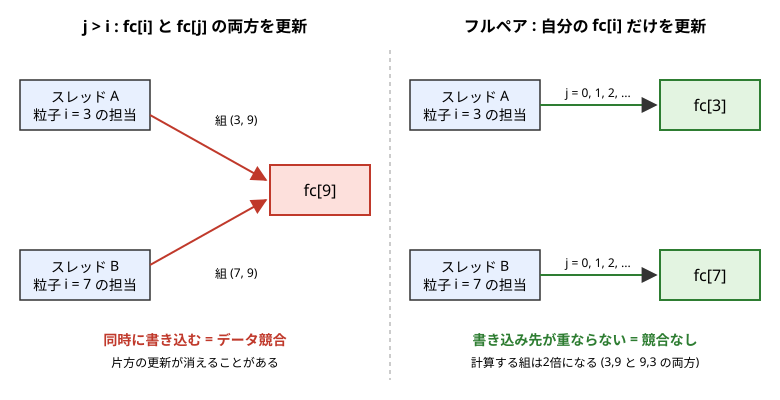

[← 目次に戻る](../README.md)

## 8. **OpenMPによる並列計算**
7章でセルリストを実装して、計算量は粒子数$N$に比例するようになりました。それでも、数万〜数十万粒子を長時間計算するには、1つのCPUコアだけでは足りません。いまのPCや計算機のCPUには複数のコア（私のMacは8コア）が入っているので、**複数のコアで同時に計算させれば**、その分だけ速くなるはずです。この章では、**OpenMP**を使ってMDの力の計算を並列化します。次のことを行います。

- OpenMPの基本（スレッド、共有メモリ、`#pragma omp parallel for`）を知る
- OpenMPを有効にしてコンパイルし、スレッド数を指定して実行する
- 並列化したときに起きる**データ競合**を理解し、避けられる形に力の計算を書き換える
- `reduction`でポテンシャルエネルギーの和を並列化する
- 並列化前後で結果が一致することを確かめ、計算時間を比べる



### 8.1 OpenMPとは
CPUのコアが4つあっても、普通のプログラムは1つのコアしか使いません。プログラムの中で複数のコアに仕事を分けて同時に実行させるのが**並列計算**です。

OpenMPでは、プログラムを実行する流れ（**スレッド**）を複数立ち上げて、`for`ループの繰り返しをスレッドに分担させます。たとえば1000回のループを4スレッドで実行すると、各スレッドが250回ずつを同時に担当します。ポイントは**共有メモリ**であることです。すべてのスレッドが同じメモリ（`cd`, `vl`, `fc`などの配列）を見ているので、データを受け渡す仕組みを自分で書く必要はありません。

そして、OpenMPは**元のプログラムに`#pragma omp ...`という指示（ディレクティブ）を1行足すだけ**で使えます。ループの中身はほとんどそのまま使えるので、すでに動いているシリアルのプログラムを並列化するのに向いています。ただし、**何も考えずに足すだけだと間違った結果になる**ことがあります（8.4節）。

### 8.2 コンパイルと実行
OpenMPを使うには、コンパイル時とリンク時に`-fopenmp`をつけます。`Makefile`を次のように変更しました。
```make
CC=gcc
CFLAGS=-Wall -fopenmp
LDFLAGS=-fopenmp
```
`-fopenmp`をつけないと、`#pragma omp`の行は**無視されて**、シリアルのプログラムとしてコンパイルされます（エラーにはなりません）。このとき`-Wall`をつけていると`ignoring '#pragma omp parallel' [-Wunknown-pragmas]`という警告が出るので、つけ忘れに気づけます。

**macOSの場合の注意**: macOSの`gcc`の実体はApple clangで、`-fopenmp`が使えません（`clang: error: unsupported option '-fopenmp'`）。次のどちらかで対処します。

- Homebrewで本物のgccを入れる（`brew install gcc`）。`gcc-15`のようにバージョン付きの名前になるので、`make CC=gcc-15`とします。この章の実行は、こちらで行いました。
- Apple clangのまま、OpenMPのライブラリを入れる。`brew install libomp`をしたうえで、次のようにします。

```bash
make CC=gcc CFLAGS="-Wall -O3 -Xpreprocessor -fopenmp -I$(brew --prefix libomp)/include" \
     LDFLAGS="-L$(brew --prefix libomp)/lib" LDLIBS="-lomp"
```
こちらでも同じ結果になることを確認しました。研究室のLinuxの計算機では、普通の`gcc`が`-fopenmp`に対応しているので、`make`だけで大丈夫です。

スレッド数は、環境変数`OMP_NUM_THREADS`で指定します。プログラムを書き換える必要はありません。
```bash
make CC=gcc-15
OMP_NUM_THREADS=4 ./md_simulation input.txt
```
`OMP_NUM_THREADS`を指定しないと、そのマシンのコア数（の最大値）が使われます。複数人で使う計算機では、他の人の計算の邪魔にならないよう、**スレッド数は必ず指定してください**。コア数はmacOSでは`sysctl -n hw.ncpu`、Linuxでは`nproc`でわかります。

`md_simulation.c`では、起動時に実際のスレッド数を表示するようにしました。OpenMPなしでコンパイルしても動くように、`#ifdef _OPENMP`で囲んでいます（`-fopenmp`をつけたときだけマクロ`_OPENMP`が定義されます）。
```c
#ifdef _OPENMP
#include <omp.h>
#endif
...
#ifdef _OPENMP
    printf("OpenMP : %d threads\n",omp_get_max_threads());
    double t_start = omp_get_wtime();
#else
    printf("OpenMP : not used\n");
#endif
```
`omp_get_wtime()`は経過時間（秒）を返す関数で、メインループが終わった後に`omp_get_wtime() - t_start`を表示しています。並列計算では、`clock()`は**全スレッドのCPU時間の合計**を返すので、経過時間の計測には使えません。

### 8.3 最初の例: 簡単なループを並列化する
まず、一番簡単なループで試します。`update.c`の`update_position()`は、各粒子の位置を速度の分だけ動かします。
```c
void update_position(int npa, double dt, double *cd, double *nvl){

    int i;

    #pragma omp parallel for
    for(i=0; i<npa*3; i+=3){
        cd[i]   += nvl[i]  *dt;
        cd[i+1] += nvl[i+1]*dt;
        cd[i+2] += nvl[i+2]*dt;
    }

}
```
`#pragma omp parallel for`を`for`の直前に書くだけです。これで、`i`の繰り返しが複数のスレッドに分けて実行されます。この例がうまくいくのは、**繰り返しどうしが独立**だからです。粒子`i`の繰り返しは、`cd[i]`〜`cd[i+2]`にしか書き込まず、他の粒子の値を使いません。どの順番で、どのスレッドが実行しても結果は同じです。

並列化できるループの条件は、これに尽きます。**「繰り返しの順番を入れ替えても結果が変わらない」ループなら、並列化できます**。

なお、この`update_position()`への`#pragma`は、**最終的なコードには入れていません**（8.7節で理由を説明します）。

### 8.4 データ競合
次に、本命の力の計算を考えます。7章の`calc_force_pot_LJ_cell()`は、`j > i`の組だけを調べて、作用反作用の法則で`fc[i]`と`fc[j]`を**両方**更新していました。
```c
if(j <= i){ continue; }
...
fc[3*i] += df[0];   fc[3*i+1] += df[1]; fc[3*i+2] += df[2];
fc[3*j] -= df[0];   fc[3*j+1] -= df[1]; fc[3*j+2] -= df[2];
```
この形のまま、セルのループに`#pragma omp parallel for`をつけるとどうなるでしょうか。粒子`i = 3`を担当するスレッドAと、粒子`i = 7`を担当するスレッドBが、どちらも粒子`j = 9`と組になっているとします（図の左）。このとき両方のスレッドが`fc[9]`に書き込みます。`fc[9] -= df`は、実際には次の3つの操作です。

1. `fc[9]`をメモリから読む
2. `df`を引く
3. 結果を`fc[9]`に書き戻す

2つのスレッドがほぼ同時に1.を実行すると、**両方が同じ古い値を読み**、それぞれ引き算をして、後から書き込んだほうの結果だけが残ります。片方の更新が消えてしまうのです。このように、複数のスレッドが同じメモリに、順番の保証なく書き込むことを**データ競合**（race condition）といいます。

実際に、並列化しただけのコードで`test_cell_list`を動かしてみると、次のようになりました（500粒子、4スレッド）。
```txt
max |force error| = 1.526e+00, |potential error| = 2.456e-11
NG
```
もう一度実行すると`1.297e-01`となり、実行のたびに違う値になります。7章では$10^{-15}$だった力の誤差が、$1$程度に増えています。**エラーにはならず、プログラムも止まらず、それらしい値が出る**のが、データ競合の怖いところです。しかも、スレッド数が1なら競合は起きないので、気づきにくいバグになります（`OMP_NUM_THREADS=1`では誤差は$10^{-15}$のままでした）。なお、ポテンシャルエネルギーの誤差が小さいのは、`pot_erg`には次の8.6節の`reduction`を使っていて、競合が起きないからです。

対処法はいくつかあります。

- **`#pragma omp atomic`**: 1つの代入文を、他のスレッドと同時にならないように実行させる。`fc`の更新1回ごとに待ちが発生するので、遅くなります。
- **`#pragma omp critical`**: 囲んだ範囲を1スレッドずつしか実行できなくする。さらに遅くなります。
- **書き込み先が重ならないように、アルゴリズムを変える**。

この章では、3つ目を選びます。

### 8.5 フルペア方式: 各粒子は自分の力だけを更新する
`j > i`の組だけを調べるのをやめて、**`j != i`のすべての組**を調べます。そして、粒子`i`は**自分の`fc[i]`だけ**を更新します（図の右）。組`(3, 9)`は、`i = 3`のときと`i = 9`のときの2回調べられますが、`i = 3`のときは`fc[3]`だけ、`i = 9`のときは`fc[9]`だけを更新します。粒子`i`を担当するスレッドは1つだけなので、`fc[i]`に書き込むスレッドは常に1つで、競合が起きません。`cd`は読むだけなので、何スレッドが同時に読んでも問題ありません。

```c
if(j == i){ continue; }  // 自分自身は除く。j > i の制限はしない
...
pot_erg += 0.5*phi;  // 組 (i,j) は j 側からも数えられるので半分
// 書き込むのは fc[i] だけ
fc[3*i]   += dphi*dd[0];
fc[3*i+1] += dphi*dd[1];
fc[3*i+2] += dphi*dd[2];
```
力は、7章までは`fc[i]`に`+df`、`fc[j]`に`-df`としていました。フルペアでは、`i`と`j`を入れ替えても同じ式なので、`i`側の`+df`だけを足せば十分です。ポテンシャルエネルギーは、各組が2回数えられるので、`0.5*phi`を足して調整します。

代償として、**調べる組の数が2倍になり、計算量も2倍**になります。1スレッドで実行すると、7章の`j > i`版より遅くなります（8.9節）。しかし、スレッドを増やして取り返せるので、並列計算では全体として得になります。このように、並列化では「シリアルで最速のアルゴリズム」がそのまま使えるとは限らず、**計算量が増えても並列化しやすい形に書き換える**ことがよくあります。

### 8.6 力の計算の並列化
フルペア方式になった`calc_force_pot_LJ_cell()`に、OpenMPのディレクティブをつけます（`cell_list.c`）。
```c
    #pragma omp parallel for collapse(3) reduction(+:pot_erg)
    for(int cz = 0; cz < ncell; cz++){
    for(int cy = 0; cy < ncell; cy++){
    for(int cx = 0; cx < ncell; cx++){
        // 周囲の27セル (自分を含む)
        for(int ez = -1; ez <= 1; ez++){
        for(int ey = -1; ey <= 1; ey++){
        for(int ex = -1; ex <= 1; ex++){
            ...
            for(int i = head[cx + cy*ncell + cz*ncell*ncell]; i != -1; i = next[i]){
                for(int j = head[c]; j != -1; j = next[j]){
                    ...
```
セルのループ（`cz`, `cy`, `cx`の3重ループ）の外側を並列化しています。セルごとに仕事を分担するので、各粒子`i`はそれが属するセルを担当する1つのスレッドだけが処理します。ここで、次の3つの指定をしています。

**`collapse(3)`**: 3重ループを1つにつなげて、`ncell^3`個のセルをスレッドに分けます。`collapse`をつけないと、一番外側の`cz`のループ（`ncell`個）だけが分担されます。`ncell`は`nla = 5`で3、`nla = 10`でも6しかなく、スレッド数より少なくなりやすいので、全体を分けたほうがバランスよく分担できます。

**shared と private**: 並列領域の中の変数は、**shared**（全スレッドで共有）か**private**（スレッドごとに別々のコピー）のどちらかになります。

- `cd`, `fc`, `head`, `next`, `ncell`など、並列領域の外で宣言された変数は、デフォルトで**shared**です。どのスレッドも同じものを見ます。
- `r2`, `dd`, `phi`のような**計算の途中で使う一時変数**がsharedのままだと、スレッド同士が互いの値を上書きしてしまい、データ競合になります。**privateにする必要があります**。

privateにする方法は2つあります。1つは`private(i,j,c,r2,dd,...)`のように**一覧を書く**方法で、MPS法のコードなどではこの書き方をしています。変数が多いと書き忘れやすく、書き忘れるとデータ競合になります。もう1つは、**一時変数を並列領域の中（ループの中）で宣言する**方法です。ループの中で宣言した変数は、自動的にprivateになります。7章までは、関数の先頭でまとめて`int i,j,c;`のように宣言していましたが、ここでは`for(int i = ...)`や`double r2 = ...;`のように、使う場所で宣言するように書き換えました（C99以降の書き方です）。ループ変数（`cz`など）は、`parallel for`の対象のループ変数なら自動的にprivateです。

**`reduction(+:pot_erg)`**: ポテンシャルエネルギー`pot_erg`は、全粒子の組の和を取ります。これをsharedのままスレッドが同時に`pot_erg += ...`すると、`fc`と同じデータ競合になります。`reduction(+:pot_erg)`と書くと、OpenMPが次の処理を自動的に行います。

1. 各スレッドに、`0`で初期化された**private**な`pot_erg`のコピーを持たせる
2. 各スレッドは、自分のコピーに足し込む（競合しない）
3. ループが終わったとき、全スレッドのコピーを足し合わせて、元の`pot_erg`に入れる

「和（`+`）を取る変数」にはこの形を使う、と覚えてください。`+`のほか、`*`, `min`, `max`なども指定できます。

**並列化しなかった部分**: `make_cell_list()`は並列化していません。粒子を順に連結リストの先頭に挿入する処理（`next[i] = head[c]; head[c] = i;`）は、複数のスレッドが同じセルの`head[c]`を同時に書き換える可能性があり、ここもデータ競合になるためです。リストの作成は計算量が$N$で、力の計算（周囲27セルの粒子との組）に比べるとずっと軽いので、逐次のままで問題ありません。

### 8.7 他のループは並列化するか
位置や速度の更新（`update.c`）や、温度・運動エネルギーの計算（`temp.c`、こちらは和なので`reduction`を使います）にも`#pragma omp parallel for`をつけることができます（8.3節の例）。実際につけて、メインループの時間を比べてみました。`nla = 10, 14`、1, 4, 8スレッドで比べましたが、**ほとんど変わりませんでした**（たとえば`nla = 14`・4スレッドで0.473 sが0.480 s）。

理由は、これらのループは**1回の繰り返しの仕事が小さく**、ループ全体も力の計算に比べるとずっと短いからです。並列化にはスレッドへの仕事の割り当てと待ち合わせの**オーバーヘッド**があり、仕事が小さいとそのオーバーヘッドのほうが大きくなって、むしろ遅くなることもあります。力の計算が全体の計算時間の大半を占めているので、**重いところだけを並列化すれば十分**です。このため、力の計算以外は変更していません。

並列化では、**どこが重いかを測ってから**、重いところから並列化するのが基本です。

### 8.8 検証
7章と同様に、**まず力の計算だけを取り出して、総当たり版（シリアル）と比べます**。`test_cell_list`は7章のものをそのまま使います（総当たり版`calc_force_pot_LJ()`と、新しい並列のセルリスト版を比べます）。スレッド数1と4の両方で確かめます。
```bash
OMP_NUM_THREADS=1 ./test_cell_list init.dat 2.5
OMP_NUM_THREADS=4 ./test_cell_list init.dat 2.5
```
```txt
npa = 500, side = 8.487886, cutoff = 2.500000
potential : -3235.022197025551 (all pairs) -3235.022197025520 (cell list)
max |force error| = 5.995e-15, |potential error| = 3.047e-11
OK
```
```txt
npa = 500, side = 8.487886, cutoff = 2.500000
potential : -3235.022197025551 (all pairs) -3235.022197025526 (cell list)
max |force error| = 5.995e-15, |potential error| = 2.501e-11
OK
```
どちらも`OK`でした。ポテンシャルエネルギーの誤差が7章（$10^{-12}$）より少し大きいのは、`0.5*phi`を2回足す形になったことと、`reduction`で足し算の順番が変わったためで、丸め誤差の範囲です。

次に、MDを最後まで動かして、7章の結果と比べます。`nla = 5`、`finish_time = 1.0`で、スレッド数1と4の最終行は、どちらも7章と同じでした。
```txt
  1.0003 (2151) -2750.0656   0.7245   (7章)
  1.0003 (2151) -2750.0656   0.7245   (8章, 1スレッド)
  1.0003 (2151) -2750.0656   0.7245   (8章, 4スレッド)
```
表示している桁では一致しています。ただし、並列版では足し算の順番が（スレッド数や実行ごとに）変わるので、**最後の桁（丸め誤差）は一致するとは限りません**。MDはカオス的な系なので、わずかな差も時間とともに指数関数的に拡大して、**十分長い時間が経つと、軌道は別のものになります**。これは並列化のバグではなく、シリアルでも、足し算の順番を変えただけで起こることです。したがって、並列化の検証では「長時間の軌道が一致すること」を求めるのではなく、**短い時間での一致**（力が丸め誤差の範囲で一致すること）や、エネルギーなどの**統計的な量**が一致することを確かめます。

### 8.9 計算時間の比較
スレッド数を変えて、計算時間を測ります。7章と同様に、`nla`を変えて`mk_init`で初期配置を作り、`finish_time = 0.05`（107ステップ）で実行して、**ファイル出力を含む全体の実行時間**を測りました。3回測った最小値です。Apple SiliconのMac（8コア）で測っています。「7章」は7章のシリアル版（`j > i`）です。速度向上率は、8章のコードを1スレッドで実行した時間に対する比です。

| nla | 粒子数 | 7章 [s] | 1スレッド [s] | 2 [s] | 4 [s] | 8 [s] |
|---:|---:|---:|---:|---:|---:|---:|
| 10 | 4000 | 0.50 | 0.89 | 0.45 (2.0倍) | 0.26 (3.4倍) | 0.21 (4.2倍) |
| 12 | 6912 | 0.75 | 1.13 | 0.59 (1.9倍) | 0.32 (3.5倍) | 0.26 (4.3倍) |
| 14 | 10976 | 1.09 | 1.62 | 0.86 (1.9倍) | 0.52 (3.1倍) | 0.44 (3.7倍) |

どの条件でも、最終行（`nla = 12`では`0.0502 (107) -44017.1351 0.7080`など）は、スレッド数によらず7章の値と一致しました。

- **スレッド数を増やすと速くなります**。2スレッドでほぼ2倍、4スレッドで3倍強です。
- **8スレッドでも8倍にはなりません**。理想的には「スレッド数倍」ですが、次の理由で下回ります。
  - 並列化していない部分（セルリストの作成、ファイル出力、位置・速度の更新など）は、スレッドを増やしても速くなりません（**アムダールの法則**）。
  - 計算が速くなると、メモリからのデータの読み出しがボトルネックになります（メモリ帯域）。
  - Apple Siliconのコアは、高性能コアと省電力コアの混成で、性能が揃っていません。
- **フルペア方式は計算量が2倍**なので、1スレッドでは7章の`j > i`版より約1.5倍遅くなっています。2スレッド以上で、ようやく7章のシリアル版より速くなります。8スレッドでも7章に対して2.4〜2.9倍です。計算量を倍にしても、並列化の効果のほうが大きいということです。

粒子数が小さい（たとえば`nla = 5`の500粒子）場合は、1ステップの計算が短すぎて、スレッド数を増やしても効果が小さくなります。並列化は、粒子数が多くて1ステップの計算が重いときに効きます。

### 8.10 実行例
`nla = 5`の`init.dat`を使って、スレッド数4で実行します。
```bash
make CC=gcc-15
./mk_init 5 0.817657464660018 0.722 1 init.dat
OMP_NUM_THREADS=4 ./md_simulation input.txt
```
最初と最後の部分は次のようになります（時間は環境によります）。
```
OpenMP : 4 threads
npa : 500, side : 8.487886, h : 0.000465, target_temp : 0.722000
******* START SIMULATION *********
...
******* END SIMULATION *********
time (step) potential T 
  1.0003 (2151) -2750.0656   0.7245 
elapsed time of main loop : 0.928 s
```
同じ計算が、1スレッドでは3.1秒かかりました。

### 8.11 発展
OpenMPは1台の計算機の中のコア（共有メモリ）の並列化です。**数百〜数千コアを使う計算は、複数の計算機（ノード）にまたがる**ので、メモリが共有されません。この場合は**MPI**を使い、粒子（や領域）を各プロセスに分けて、境界付近の粒子のデータを通信で受け渡します。MPIとOpenMPを組み合わせた**ハイブリッド並列**（ノード間はMPI、ノード内はOpenMP）もよく使われます。MDの並列化では、箱を領域分割して各プロセスが担当する領域の粒子を計算する方法が一般的で、7章のセルリストとも相性がよい方法です。

また、OpenMPには、今回使わなかった`schedule`（仕事の分け方の指定）などがあります。計算量が不均一なとき（粒子の分布に偏りがあるときなど）は、`schedule(dynamic)`が有効なことがあります。詳細は参考文献を参照してください。

**【参考文献】**
- [並列プログラミング入門](https://www.utp.or.jp/book/b307057.html)
- [OpenMPの基礎 片桐孝洋](https://www.r-ccs.riken.jp/wp/wp-content/uploads/2020/09/katagiri190425.pdf)


[← 目次に戻る](../README.md)
