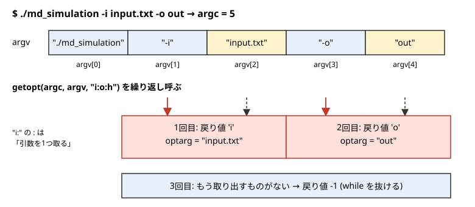

[← 目次に戻る](../README.md)

## 9. **オプションを与えてみよう**
ここまでで、`md_simulation`は`./md_simulation input.txt`のように、インプットファイルを1つ与えれば動くようになりました。しかし、研究では**同じインプットファイルで、出力先だけ変えて何回も実行したい**場面がよくあります（温度や乱数のシードを変えたパラメータスキャンなど）。そのたびに`input.txt`をコピーして`output_dir`の行を書き換えるのは面倒ですし、ミスのもとです。この章では、`ls -l -a`のように**オプションをつけて実行できる**ようにプログラムを改造します。次のことを行います。

- `argc`, `argv`のおさらいをして、`argv[1]`のような位置決め打ちの限界を知る
- POSIXの`getopt()`によるオプションの解析を知る
- `md_simulation`に`-i`, `-o`, `-h`を、`mk_init`に`-n`, `-d`, `-t`, `-s`, `-o`を実装する
- シェルのループと組み合わせて、パラメータを変えた計算を一括で実行する



### 9.1 位置決め打ちの限界
5章の`mk_init`は、`./mk_init 5 0.817657464660018 0.722 1 init.dat`のように、引数を**決まった順番**で与える必要がありました。この方式には次の問題があります。

- 何番目が何の値なのか、**コマンドを見ただけではわからない**（`0.722`は密度？ 温度？）。
- 1つだけ値を変えたいときも、**全部の引数を書かなければならない**。
- 引数が増えると、順番を間違えやすい。しかも、間違えても`atof`は何も言わずに動いてしまう。

一方で、`ls -l -a`のようなbashのコマンドは、`-l`や`-a`といった**オプション**をつけて動作を変えます。オプションは順番を気にせず（`ls -a -l`でも同じ）、必要なものだけ書けばよく、名前がついているので意味もわかります。自作のプログラムも、同じようにできます。

### 9.2 argc, argvのおさらい
`main`関数は、実行時の引数を`argc`と`argv`で受け取ります。
```c
int main(int argc, char ** argv)
```
- `argc`: 引数の数（**プログラム名を含む**）
- `argv`: 引数の文字列の配列。`argv[0]`がプログラム名、`argv[1]`以降が引数

たとえば`./md_simulation -i input.txt -o out`と実行すると、`argc = 5`で、`argv`は上の図のようになります。`-i`や`input.txt`は、どちらも**ただの文字列**です。「`-i`の次の文字列はファイル名」といったルールは、プログラムの側で決めて、自分で解釈する必要があります。この解釈を代わりにやってくれるのが`getopt()`です。

### 9.3 getoptの使い方
`getopt()`は、`<unistd.h>`にある関数で、`argv`から**オプションを1つずつ取り出して**くれます。呼ぶたびに次のオプションの文字を返し、取り出すものがなくなると`-1`を返します。基本の形は次のとおりです。
```c
#include <unistd.h>

int opt;
while((opt = getopt(argc, argv, "i:o:h")) != -1){
    switch(opt){
        case 'i': input_file = optarg; break;
        case 'o': output_dir = optarg; break;
        case 'h': print_usage(argv[0]); exit(EXIT_SUCCESS);
        default : print_usage(argv[0]); exit(EXIT_FAILURE);
    }
}
```
3つ目の引数`"i:o:h"`は**optstring**といって、使えるオプションの文字を並べたものです。

- `i`, `o`, `h`: 使えるオプション文字
- 文字の後ろの`:`: **そのオプションが引数を1つ取る**ことを表す。`i:`なら`-i input.txt`のように、後ろに値が続く。`h`には`:`がないので、`-h`だけで使う。

取り出した引数は、グローバル変数`optarg`（文字列へのポインタ）に入ります。`optarg`は`argv`の中の文字列を指しているだけなので、あとで使うなら、そのまま使うか`snprintf`などでコピーします。

`getopt()`は次のような便利な動作もします。

- `-i input.txt`のように空白で区切っても、`-iinput.txt`のようにくっつけても読める。
- `-a -b`は`-ab`とまとめて書ける（引数を取らないオプションの場合）。
- **未知のオプション**（`-x`）や**引数が足りない**（`-i`だけで終わる）場合は、`getopt()`が自分でエラーメッセージを`stderr`に出して、`'?'`を返す。`switch`の`default`で受けて、usageを表示して終了させます。

`getopt()`が`-1`を返してループを抜けたあと、まだオプションでない引数（`./a.out -v file1 file2`の`file1`など）が残っていれば、`argv[optind]`以降に並んでいます。今回のプログラムでは使いません。

### 9.4 md_simulationへの実装
`md_simulation`のオプションは、次のようにします。

| オプション | 意味 |
|---|---|
| `-i <file>` | インプットファイル（**必須**） |
| `-o <dir>` | 出力ディレクトリ。インプットファイルの`output_dir`を**上書き**する |
| `-h` | usageを表示して終了 |

`md_simulation.c`のインプットファイルを決める部分を、次のように書き換えました。
```c
    char *input_file = NULL;
    char *output_dir_opt = NULL;  // -o で指定された出力ディレクトリ (指定なしなら NULL)
    int opt;

    // オプションの解析 : -i input_file (必須), -o output_dir, -h
    while((opt = getopt(argc,argv,"i:o:h")) != -1){
        switch(opt){
            case 'i': input_file = optarg; break;
            case 'o': output_dir_opt = optarg; break;
            case 'h': print_usage(argv[0]); exit(EXIT_SUCCESS);
            default : print_usage(argv[0]); exit(EXIT_FAILURE);  // '?' : 未知のオプション, 引数不足
        }
    }
    if(input_file == NULL){
        fprintf(stderr,"%s: -i input_file is required\n",argv[0]);
        print_usage(argv[0]);
        exit(EXIT_FAILURE);
    }
    parameters = read_parameters_from_inputfile(&input_file);
    // -o が指定されたら、input file の output_dir を上書きする
    if(output_dir_opt != NULL){
        snprintf(parameters->output_dir,sizeof(parameters->output_dir),"%s",output_dir_opt);
    }
```
ポイントは次の3つです。

- `-i`が指定されなかったときは`input_file`が`NULL`のままなので、それで検出して、usageを出して終了します。
- `-o`は、インプットファイルを読み込んだ**あとで**上書きします。`parameters->output_dir`はサイズ256の配列なので、`snprintf`で長すぎる文字列も切り捨てて安全にコピーします。
- 上書きは`parameters`の中身に対して行うので、`parameters.txt`（6章）にも**上書き後の値**が書かれます。あとから「この結果はどの設定で計算したのか」を確認できます。

usageを表示する関数は、`main`の前に書いています。
```c
void print_usage(const char *prog){
    fprintf(stderr,"usage : %s -i input_file [-o output_dir] [-h]\n",prog);
    fprintf(stderr,"  -i input_file : input file (required)\n");
    fprintf(stderr,"  -o output_dir : output directory (overrides output_dir in the input file)\n");
    fprintf(stderr,"  -h            : show this help\n");
}
```
**インプットファイルに書く値と、オプションで与える値の使い分け**は、「実行のたびに変わりやすいもの」だけをオプションにする、くらいで十分です。何でもオプションにすると、コマンドが長くなって、かえって再現しにくくなります。パラメータの本体はインプットファイルに残しておき（そのファイル自体が記録になります）、オプションは「出力先」のような、**同じ設定で変えたいもの**に絞りました。

### 9.5 mk_initへの実装
`mk_init`は、5章では5つの引数すべてが必須でした。オプションにして、それぞれに**既定値**をつけます。指定しなかったオプションは既定値になるので、`./mk_init`だけでも初期配置ができます。
```c
    // 既定値 (オプションで上書きする)
    int nla = 5;
    double density = 0.817657464660018;
    double target_temp = 0.722;
    int seed = 1;
    char *output_file = "init.dat";
    int opt;

    while((opt = getopt(argc,argv,"n:d:t:s:o:h")) != -1){
        switch(opt){
            case 'n': nla = atoi(optarg); break;
            case 'd': density = atof(optarg); break;
            case 't': target_temp = atof(optarg); break;
            case 's': seed = atoi(optarg); break;
            case 'o': output_file = optarg; break;
            case 'h':
            default :
                fprintf(stderr,"usage : %s [-n nla] [-d density] [-t target_temp] [-s seed] [-o output_file]\n",argv[0]);
                exit(opt == 'h' ? EXIT_SUCCESS : EXIT_FAILURE);
        }
    }
```
| オプション | 意味 | 既定値 |
|---|---|---|
| `-n` | 単位格子の数`nla`（粒子数は$4\,nla^3$） | 5 |
| `-d` | 数密度 | 0.817657464660018 |
| `-t` | 設定温度 | 0.722 |
| `-s` | 速度の乱数のシード | 1 |
| `-o` | 出力ファイル名 | init.dat |

既定値は、この章までの例（`nla = 5`の500粒子）と同じにしています。`./mk_init`で作った`init.dat`は、8章の`./mk_init 5 0.817657464660018 0.722 1 init.dat`で作ったものと**完全に一致**しました（`cmp`で確認）。

**数値の変換について**: `atoi`/`atof`は、変換できない文字列を渡されても**エラーを返さず0にします**。たとえば`./mk_init -t abc`は、温度`0`の初期配置を何も言わずに作ってしまいます。入力ミスに気づきたいときは、`strtod`（`int`には`strtol`）を使います。
```c
char *end;
double v = strtod(optarg, &end);
if(end == optarg || *end != '\0'){   // 1文字も変換できない、または途中で止まった
    fprintf(stderr,"invalid number : %s\n",optarg);
    exit(EXIT_FAILURE);
}
```
`end`には「変換できたところの次の位置」が入ります。文字列を最後まで変換できていれば`*end`は終端文字`'\0'`になるので、そうでなければ数値でない文字が混じっていたことがわかります。このチュートリアルのコードは簡潔さを優先して`atoi`/`atof`のままにしていますが、他人に渡すツールでは入れておくと親切です。

### 9.6 実行例
ビルドは8章と同じです。
```bash
make CC=gcc-15
./mk_init
OMP_NUM_THREADS=4 ./md_simulation -i input.txt
```
最終行は8章と同じ`1.0003 (2151) -2750.0656   0.7245`でした。`-o`で出力先を変えると、`parameters.txt`の`output_dir`も変わります。
```bash
OMP_NUM_THREADS=4 ./md_simulation -i input.txt -o out_T0.8
grep output_dir out_T0.8/parameters.txt
```
```txt
output_dir = out_T0.8
```
`-h`は、usageを表示して正常終了します（終了コードは0）。
```bash
./md_simulation -h
```
```txt
usage : ./md_simulation -i input_file [-o output_dir] [-h]
  -i input_file : input file (required)
  -o output_dir : output directory (overrides output_dir in the input file)
  -h            : show this help
```
未知のオプション、`-i`の引数がない場合、`-i`自体がない場合は、メッセージとusageを表示して異常終了（終了コード1）します。usageは同じなので省略します。
```txt
$ ./md_simulation -x
./md_simulation: illegal option -- x

$ ./md_simulation -i
./md_simulation: option requires an argument -- i

$ ./md_simulation -o foo
./md_simulation: -i input_file is required
```
最初の2つのメッセージは`getopt()`が出したもので、3つ目は`md_simulation.c`が出したものです（`getopt()`のメッセージの文言は環境によって少し違います）。

**パラメータを変えて複数回実行する**: シェルの`for`ループと組み合わせると、パラメータスキャンが簡単に書けます。たとえば、乱数のシードだけ変えた3つの初期配置で、同じ設定のシミュレーションを行います。
```bash
for s in 1 2 3; do
    ./mk_init -s $s -o init.dat
    OMP_NUM_THREADS=4 ./md_simulation -i input.txt -o out_s$s
done
```
`out_s1`, `out_s2`, `out_s3`の3つのディレクトリに、結果が別々に保存されます。なお、このループは`init.dat`を上書きするので、元のサンプルに戻したいときは既定値のまま`./mk_init`を実行してください（seed 1 の`init.dat`が作り直されます）。最終行は、それぞれ次のようになりました。
```txt
  1.0003 (2151) -2750.0656   0.7245   (seed 1)
  1.0003 (2151) -2761.3063   0.7194   (seed 2)
  1.0003 (2151) -2760.8388   0.7239   (seed 3)
```
`input.txt`は1つだけで、`-o`で出力先を変えているので、どの結果がどの条件のものかは、ディレクトリ名と`parameters.txt`でわかります。同じ要領で、`mk_init`の`-t`で温度を、`-n`で粒子数を変えた初期配置を作ることもできます。ただし、`md_simulation`の設定温度はインプットファイルの`target_temp`なので、温度を変える場合は、それも合わせる必要があります。

### 9.7 発展: getopt_long
`getopt()`は`-i`のような**1文字のオプション**だけを扱えます。`--input input.txt`のような**長いオプション**を使いたいときは、`getopt_long()`（`<getopt.h>`）を使います。
```c
#include <getopt.h>

static struct option long_options[] = {
    {"input",  required_argument, NULL, 'i'},
    {"output", required_argument, NULL, 'o'},
    {"help",   no_argument,       NULL, 'h'},
    {NULL, 0, NULL, 0}
};
while((opt = getopt_long(argc, argv, "i:o:h", long_options, NULL)) != -1){
    // switch は getopt のときと同じ
}
```
長いオプションの名前と、対応する短いオプションの文字を表にして渡します。これで`-i input.txt`でも`--input input.txt`でも同じ動作になります。

なお、`getopt()`はPOSIXの標準で、macOSでもLinuxでも使えます。`getopt_long()`はGNUの拡張ですが、Linuxのglibcだけでなく、macOSにも入っています。また、GNUの`getopt`には、オプションでない引数の後ろにあるオプションも読む（`./a.out file -v`の`-v`も認識する）という、POSIXとは違う動作があります。環境の違いが気になるときは、オプションを先に書く習慣にしておけば安全です。

オプションが何十個にもなる場合や、サブコマンド（`git commit`のような）が必要な場合は、`getopt`で自作するより、既存のライブラリを使うことも考えてください。このチュートリアルの規模では、`getopt()`で十分です。

[← 目次に戻る](../README.md)
